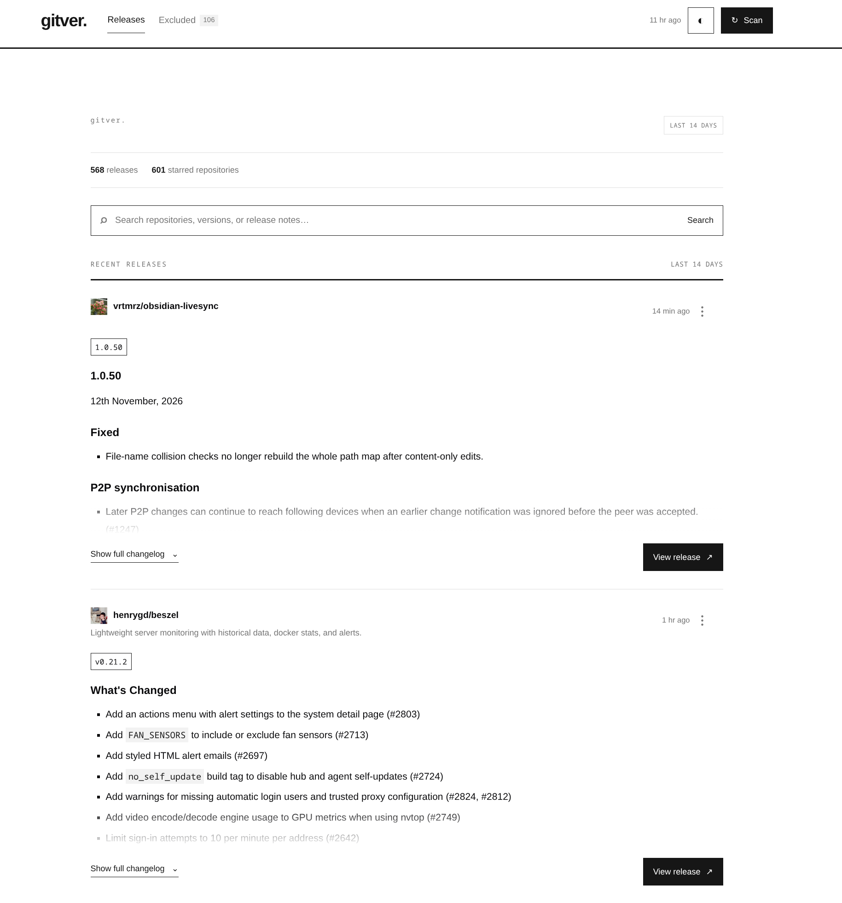
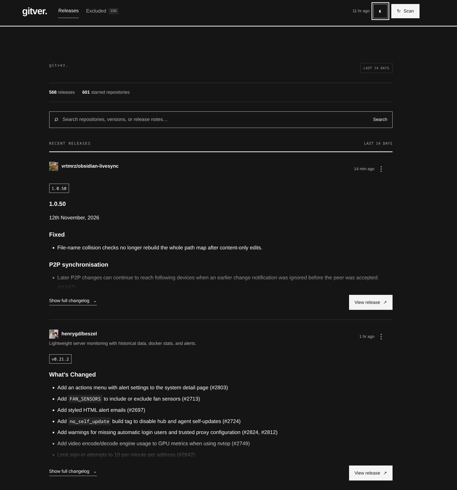

# GitVer

GitVer collects recent releases from your starred GitHub repositories in one place. It is a small Go web app with a simple interface and manual scans.

The UI uses [Oat](https://oat.ink/) with a monochrome style inspired by [Concrete](https://concrete.style/). The focus is on a lightweight interface and a short path to the release notes.

The CSS, JavaScript and HTML templates are embedded in the Go binary. HTMX is included locally, with no CDN or frontend build step. Go renders the pages and handles search and paging; small JavaScript interactions control the theme, release menus and changelog expansion. GitHub is contacted only when you start a scan.

## Screenshots

<p>
  
  
</p>

## Run with Docker Compose

1. Copy `.env.example` to `.env` and add a GitHub token. Read-only access to public repositories is enough for public stars.
2. Pull and start the published image:

   ```sh
   docker compose pull
   docker compose up -d
   ```

3. Open [http://localhost:8090](http://localhost:8090) and choose **Scan**.

Scans run only when started from the app. Releases from the last 14 days and repository exclusions are saved in `./data/releases.json`.

The image is published to `ghcr.io/vangreen/gitver` after changes reach `main`. A push to `main` updates the `latest` and `main` tags; Git tags such as `v1.2.3` publish version tags. The workflow builds images for `linux/amd64` and `linux/arm64`.

New GHCR packages are private by default. To pull without logging in on your NAS, make the `gitver` package public in the repository's **Packages** settings after the first successful build. Otherwise, log in to `ghcr.io` on the NAS using a GitHub token with `read:packages` access.

To build locally, run `docker build -t gitver:local .`, then start Compose with `GITVER_IMAGE=gitver:local docker compose up -d`.

## Use

Search the release list by repository, version, title, or release notes. Exclude a repository from its release menu, or restore it from **Excluded**. Repositories with no releases are checked again after seven days; manual exclusions stay in place until restored.

## Configuration

| Variable | Default | Description |
|---|---|---|
| `GITHUB_TOKEN` | required | GitHub API token |
| `PORT` | `8090` | Host port used by Docker Compose |
| `DATA_DIR` | `data` | Directory for releases and exclusions |

The app listens on port `8090` inside the container. `LISTEN_ADDR` can be set when running the binary directly.

## Run locally

```sh
GITHUB_TOKEN=your-token go run .
```

By default, the app listens at [http://localhost:8090](http://localhost:8090).
